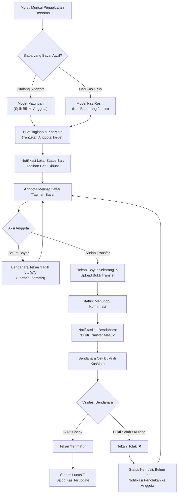

# KasMate 💰🤝

**KasMate** adalah aplikasi mobile pengelola keuangan bersama dan *split bill* modern yang dirancang khusus untuk anak kos, kelompok mahasiswa, kepanitiaan organisasi, dan teman nongkrong/trip. KasMate memecahkan masalah pelik pencatatan kas kelompok, membagi tagihan secara proporsional, serta menghilangkan rasa canggung saat menagih utang ke teman.

> Proyek Akhir Mata Kuliah Pemrograman Perangkat Bergerak (PPB) — Semester 5.

---

## 📌 Latar Belakang & Masalah

Anak kos dan kelompok mahasiswa sering menghadapi kendala dalam mengelola uang bersama:
1. **Catatan Grup WA Tertimbun:** Pembukuan manual di chat WhatsApp sering hilang atau terlupa.
2. **Kalkulasi Rumit:** Menghitung manual pembagian struk belanja (termasuk pajak, diskon, dan pembulatan) rawan salah.
3. **Rasa Canggung Saat Menagih:** Banyak anggota yang segan mengingatkan temannya yang belum bayar.
4. **Bukti Transfer Tercecer:** Bendahara kesulitan mencocokkan mutasi rekening dengan siapa yang sudah transfer.

KasMate menyatukan pencatatan, pembagian adil (*split bill*), pengunggahan bukti bayar, konfirmasi verifikasi, notifikasi lokal, dan visualisasi statistik dalam satu ekosistem terpadu.

---

## 💡 Konsep Utama: Kas Resmi vs Patungan

KasMate mendukung dua mode keuangan fleksibel sesuai kebutuhan kelompok:

### 1. Model Kas Resmi (Contoh: Kos-Kosan, Organisasi, Kas Kelas)
* **Karakteristik:** Terdapat saldo bersama (*pool of funds*) yang dikumpulkan secara berkala (misal iuran bulanan Rp 50.000).
* **Peran Bendahara:** Bendahara memegang kas dan mengalokasikan pengeluaran (misal bayar Wi-Fi kos Rp 350.000 atau beli galon).
* **Pencatatan:** Pembayaran iuran anggota otomatis menambah saldo kas grup.

### 2. Model Patungan / Split Bill (Contoh: Makan Bareng, Trip, Belanja Bahan)
* **Karakteristik:** Tidak ada saldo kas bersama (saldo awal Rp 0).
* **Talangan Anggota:** Salah satu anggota menalangi pembayaran di awal (misal Fadhil menalangi total belanja dapur Rp 121.000).
* **Pengembalian:** Anggota lain membayar bagian masing-masing langsung ke rekening/e-wallet anggota yang menalangi tersebut.

---

## 👥 Alur Pengguna (User Flows)

### A. Sudut Pandang yang Menalangi / Bendahara
1. **Buat Tagihan:** Masuk ke menu *Split Bill* atau Tambah Tagihan, tentukan judul, nominal, dan pilih anggota target.
2. **Tentukan Sumber Dana:** Pilih apakah ditalangi sendiri atau dipotong dari kas grup.
3. **Pantau Pembayaran:** Di Beranda, pantau status anggota di section *Menunggu Dibayar*. Jika belum ada respons, tekan **Tagih via WA** untuk mengirim pesan otomatis berisi nominal & rekening.
4. **Terima Notifikasi:** Menerima notifikasi lokal di status bar saat anggota mengunggah bukti bayar.
5. **Verifikasi Bukti:** Buka detail konfirmasi, lihat gambar bukti bayar, lalu tekan **Terima** (otomatis lunas) atau **Tolak**.

### B. Sudut Pandang Anggota yang Harus Membayar
1. **Cek Tagihan:** Buka aplikasi, lihat badge dan kartu tagihan aktif di section *Tagihan Saya*.
2. **Transfer:** Salin nomor rekening/bank tujuan atau pindai QR Code grup yang disediakan bendahara.
3. **Unggah Bukti Bayar:** Tekan tombol **Bayar Sekarang**, lampirkan foto/struk transfer, lalu ajukan.
4. **Status Berubah:** Status tagihan berubah menjadi *Menunggu Konfirmasi* sampai diverifikasi oleh bendahara.

---

## 🔄 Flowchart Alur Pembayaran & Verifikasi



---

## 🚀 Fitur Unggulan

- 📊 **Dashboard Finansial:** Kartu saldo kas resmi, total patungan, dan pemisahan jelas antara *Tagihan Saya* vs *Menunggu Dibayar*.
- 🔍 **Pencarian & Filter Transaksi:** Kolom pencarian realtime dan filter chips (*Lunas, Menunggu, Dibatalkan, Kas Grup, Talangan*) di layar Riwayat.
- 🛡️ **Audit Trail & Pembatalan Transaksi:** Transparansi pencatatan audit trail dengan alasan pembatalan dan koreksi keuangan otomatis.
- ⚡ **Animasi & Polish Modern:** Splash screen interaktif, shimmer loading, hero transition pada QR Code, elastic success dialogs, dan animated counters.
- 📷 **QR Code Scanner & OCR Struk:** Generate QR Code grup untuk transfer cepat, scanner QR bawaan kamera, serta OCR pemindai struk belanja.
- 📈 **Statistik Interaktif & Drill-Down:** Diagram batang bulanan, diagram lingkaran kategori pengeluaran, donat interaktif, dan lembar drill-down daftar belanja per kategori.
- 🔔 **Notifikasi Lokal & WhatsApp:** Notifikasi status bar lokal pengingat jatuh tempo, tagihan baru, dan template pesan penagihan rapi ke WhatsApp.
- 📁 **Ekspor Laporan CSV Excel-Ready:** Ekspor laporan pembukuan grup ke file `.csv` terstruktur dengan pemisah titik koma (`;`) dan format nomor WhatsApp aman notasi ilmiah di Excel.
- ☁️ **Firebase Multi-User Sync:** Autentikasi akun, sinkronisasi cloud real-time Firestore, dan penyimpanan bukti transfer subkoleksi Base64.
- 🌓 **Tema Gelap & Terang:** Dukungan penuh Dark Mode dan Light Mode yang dapat diaktifkan melalui menu Pengaturan.

---

## 🛠️ Status Pengembangan

- [x] **Fase 1: Data Model & Refactoring**
  - [x] Model `GrupKas` & `TipeGrup` (Kas Resmi vs Patungan)
  - [x] Model `Tagihan` (ditalangi vs kas grup)
  - [x] Model `KonfirmasiPembayaran` & bukti bayar
  - [x] Relasi anggota & status pembayaran
- [x] **Fase 2: Redesign Dashboard & Navigasi**
  - [x] Navigasi 5 Tab (Beranda, Riwayat, Split Bill, Statistik, Profil)
  - [x] Dashboard dua kartu (Kas Resmi + Patungan) dengan Animated Counter
  - [x] Pemisahan 2 section tagihan (Tagihan Saya vs Menunggu Dibayar)
  - [x] Empty state responsif & interaktif
- [x] **Fase 3: Alur Tagihan & Bukti Bayar**
  - [x] Upload bukti bayar via galeri/kamera
  - [x] Halaman konfirmasi pembayaran masuk untuk bendahara
  - [x] Halaman riwayat lengkap dengan filter status & pencarian
  - [x] Integrasi pesan penagihan WhatsApp otomatis
- [x] **Fase 4: Halaman Baru**
  - [x] Detail Grup & Pengaturan Anggota
  - [x] Tampilan & Scanner QR Code Grup
  - [x] Pusat Notifikasi In-App
  - [x] Layar Statistik & Grafik `fl_chart`
  - [x] Layar Pengaturan & Manajemen Profil
- [x] **Fase 5: Firebase Integration**
  - [x] Inisialisasi Firebase Core & Auth Gate
  - [x] Login & Registrasi multi-user
  - [x] Cloud Firestore Sync dua arah dengan `kas_store.dart`
  - [x] Penyimpanan bukti transfer Base64 gratis tanpa Firebase Blaze
- [x] **Fase 6: Animasi & UI Polish**
  - [x] Animated Splash Screen
  - [x] Shimmer Loading placeholder
  - [x] Success Dialog dengan animasi elastis
  - [x] Hero Animation QR Code
  - [x] Shared Axis Page Transitions
- [x] **Fase 7: Notifikasi Lokal**
  - [x] Inisialisasi `flutter_local_notifications` & Android 13+ permission
  - [x] Notifikasi tagihan baru
  - [x] Notifikasi bukti transfer masuk & verifikasi status
  - [x] Toggle aktifkan/nonaktifkan notifikasi di Pengaturan
- [x] **Fase 8: Dokumentasi & Panduan Proyek**

---

## 💻 Teknologi & Dependensi

* **Framework:** [Flutter](https://flutter.dev/) (SDK ^3.8.1) & [Dart](https://dart.dev/)
* **State Management:** Reactive dual-layer architecture dengan `ValueNotifier` & `ChangeNotifier`
* **Backend & Cloud:**
  * `firebase_core: ^3.12.1`
  * `firebase_auth: ^5.5.1`
  * `cloud_firestore: ^5.6.5`
* **Fitur Mobile & Native:**
  * `flutter_local_notifications: ^18.0.1` (Notifikasi status bar)
  * `mobile_scanner: ^7.5.0` (Scanner QR Code kamera)
  * `qr_flutter: ^4.1.0` (Generator QR Code)
  * `image_picker: ^1.1.2` (Kamera & Galeri bukti transfer)
  * `url_launcher: ^6.3.1` (Integrasi WhatsApp & telp)
  * `share_plus: ^10.1.4` (Ekspor & bagikan laporan)
* **Visualisasi & Animasi:**
  * `fl_chart: ^1.3.1` (Diagram garis, batang, dan lingkaran)
  * `animations: ^2.0.11` (Transisi layar Shared Axis)
  * `shimmer: ^3.0.0` (Efek shimmer loading)
  * `lottie: ^3.3.1` (Animasi vektor Lottie)

---

## 📂 Struktur Direktori

```
lib/
├── main.dart                       # Entry point, Firebase init & AuthGate
├── theme/
│   ├── app_theme.dart              # Light & Dark theme, SharedAxis transitions
│   └── theme_controller.dart       # State pengubah tema global (Dark/Light mode)
├── models/
│   ├── grup.dart                   # Data model Grup & Anggota
│   ├── tagihan.dart                # Model tagihan, riwayat, & konfirmasi bayar
│   └── pengguna.dart               # Profil pengguna & rekening
├── data/
│   ├── kas_store.dart              # Single source of truth state store & Firestore sync
│   ├── profil_store.dart           # Store profil pengguna aktif
│   └── dummy.dart                  # Fallback offline dummy data
├── utils/
│   ├── format.dart                 # Format mata uang Rupiah & input formatter
│   ├── hitung_tagihan.dart         # Logika split bill proporsional, pajak & diskon
│   └── input_validation.dart       # Validasi regex WA, rekening & nominal
├── services/
│   ├── auth_service.dart           # Firebase Authentication handler
│   ├── firestore_service.dart      # CRUD Firestore & Base64 image processor
│   └── notification_service.dart   # Local notification manager
├── widgets/
│   ├── animated_counter.dart       # Counter angka Rupiah animasi Tween
│   ├── dialog_setoran.dart         # Dialog setor kas bersama untuk bendahara
│   ├── member_tile.dart            # Komponen kartu anggota
│   ├── skor_badge.dart             # Badge skor kedisiplinan finansial
│   ├── status_badge.dart           # Badge status tagihan (Lunas, Belum, Menunggu)
│   └── success_dialog.dart         # Pop-up dialog sukses animasi elastis
└── screens/
    ├── splash_screen.dart          # Layar pembuka animasi
    ├── login_screen.dart           # Autentikasi email & password
    ├── register_screen.dart        # Pendaftaran akun baru & validasi WA
    ├── main_navigation_screen.dart # Navigasi 5 tab utama
    ├── home_screen.dart            # Dashboard ringkasan kas & tagihan
    ├── riwayat_screen.dart         # Riwayat transaksi, pencarian & filter chip
    ├── buat_tagihan_screen.dart    # Form pencatatan pengeluaran & split bill
    ├── statistik_screen.dart       # Grafik analitik pengeluaran fl_chart & drill-down
    ├── profil_screen.dart          # Profil pengguna & rekening
    ├── bayar_tagihan_screen.dart   # Upload bukti bayar anggota
    ├── konfirmasi_pembayaran_screen.dart # Verifikasi bukti bayar bendahara
    ├── buat_grup_screen.dart       # Pembuatan grup baru & pilih tipe grup
    ├── gabung_grup_screen.dart     # Gabung grup via kode undangan / QR
    ├── detail_grup_screen.dart     # Manajemen grup, anggota & hak akses
    ├── qr_grup_screen.dart         # Tampilan besar QR Code grup
    ├── scan_qr_screen.dart         # Pemindai kamera QR Code undangan
    ├── scan_struk_screen.dart      # OCR pemindai struk belanja Google ML Kit
    ├── notifikasi_screen.dart      # Log notifikasi dalam aplikasi
    ├── pengaturan_screen.dart      # Pengaturan tema, notifikasi & akun
    └── export_laporan_screen.dart  # Ekspor laporan keuangan CSV Excel-ready
```

---

## 👨‍💻 Tim Pengembang

KasMate dikembangkan sebagai Proyek Akhir Mata Kuliah Pemrograman Perangkat Bergerak (PPB).

* **Lisensi:** MIT License — silakan periksa dialog lisensi di dalam aplikasi untuk detail lisensi pihak ketiga.
