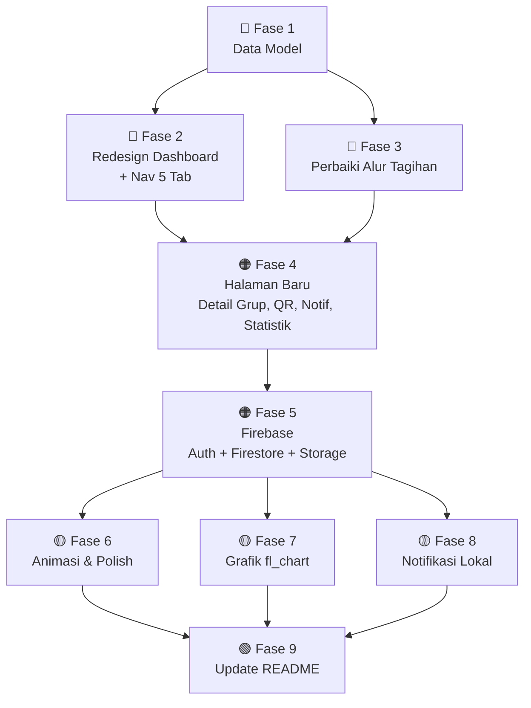

# 📋 Planning Lengkap: Upgrade KasMate

> Project Akhir PPB Semester 5 — step by step, detail per langkah

---

## Fase 1: Perbaiki Data Model ⚙️ [SELESAI - 100%]

> [!NOTE]
> ✅ **Fase 1 telah selesai dikerjakan dan diverifikasi (`No issues found!`)**

**File yang diubah:** `lib/data/kas_store.dart`, `lib/data/dummy.dart`

### Step 1.1 — Tambah field `penerimaId` di class `TagihanKas` [x]
### Step 1.2 — Tambah field `tipeGrup` di class `GrupKas` [x]
### Step 1.3 — Tambah method `tagihanSaya()` dan `menungguDibayar()` [x]
### Step 1.4 — Update data dummy [x]

**Apa:** Sekarang `TagihanKas` tidak menyimpan info "uang ini dibayar ke siapa". Tambah field `penerimaId` (ID anggota yang harus menerima uang) dan `namaPenerima` (nama yang ditampilkan).

**Kenapa:** Supaya di UI bisa tampil "Bayar ke: Citra — BCA 3456789". Tanpa ini, app selalu arahkan transfer ke bendahara, padahal yang nalangin bisa siapa aja.

**Bagaimana:**
```dart
class TagihanKas {
  // ... field yang sudah ada ...
  final String penerimaId;      // BARU: ID anggota penerima transfer
  final String namaPenerima;    // BARU: Nama penerima (untuk tampilan)
  final String bankPenerima;    // BARU: Bank penerima
  final String rekPenerima;     // BARU: No rekening penerima
}
```

### Step 1.2 — Tambah field `tipeGrup` di class `GrupKas`

**Apa:** Tambah field `tipeGrup` yang nilainya `kasResmi` atau `patungan`.

**Kenapa:** Biar app bisa bedakan tampilan:
- **`kasResmi`** (kos, organisasi): Ada saldo kas bersama, ada bendahara yang kelola uang
- **`patungan`** (makan bareng, trip): Tidak ada kas bersama, murni split bill antar anggota

**Bagaimana:**
```dart
class GrupKas {
  // ... field yang sudah ada ...
  final String tipeGrup; // BARU: 'kasResmi' atau 'patungan'
}
```

### Step 1.3 — Tambah method `tagihanMasuk()` dan `tagihanKeluar()`

**Apa:** Method untuk memfilter tagihan berdasarkan **sudut pandang user yang sedang login**.

**Kenapa:** Dashboard butuh 2 section:
- "Tagihan saya" = tagihan yang **aku harus bayar** ke orang lain → `tagihanMasuk()`
- "Menunggu dibayar" = tagihan dari orang yang **harus bayar ke aku** → `tagihanKeluar()`

**Bagaimana:**
```dart
// Di KasStore:
List<AnggotaKas> tagihanMasuk(String myId) {
  // Return anggota yang status-nya bukan lunas DAN berhubungan dengan tagihan
  // di mana myId = memberId (aku yang harus bayar)
}

List<AnggotaKas> tagihanKeluar(String myId) {
  // Return anggota yang status-nya bukan lunas DAN berhubungan dengan tagihan
  // di mana myId = penerimaId (aku yang harus menerima)
}
```

### Step 1.4 — Update data dummy

**Apa:** Perbarui data dummy di `KasStore()` constructor supaya menggunakan field-field baru (`penerimaId`, `tipeGrup`).

**Kenapa:** Biar bisa langsung di-test tanpa Firebase. Contoh dummy:
- Grup "Kas Kos 2B" → `tipeGrup: 'kasResmi'` (punya saldo kas)
- Grup "Kas Kelas TI-B" → `tipeGrup: 'patungan'` (cuma split bill)
- Tagihan "Belanja dapur" → `penerimaId: 'a1'` (bayar ke Fadhil yang nalangin)

---

## Fase 2: Redesign Dashboard & Navigasi 🏠

> [!IMPORTANT]
> Perubahan UI paling berdampak. User langsung paham begitu buka app.

### Step 2.1 — Ubah Bottom Navigation jadi 5 tab [x]

**Apa:** Sekarang bottom nav punya 4 tab (Home, Tagihan, Konfirmasi, Profil). Ubah jadi **5 tab** dengan layout baru.

**Kenapa:** Tab "Bayar Tagihan" dan "Konfirmasi" kurang intuitif sebagai tab utama. Setelah redesign dashboard, fitur bayar dan konfirmasi sudah bisa diakses dari Home. Jadi tab-nya diganti yang lebih berguna.

**Layout baru:**
```
┌──────────────────────────────────────────────────┐
│  🏠         📊         ➕         🔔        👤  │
│ Home     Statistik    Buat     Notifikasi  Profil│
│                      Tagihan                     │
└──────────────────────────────────────────────────┘
```

**Detail tiap tab:**
- **Home** → Dashboard utama (tagihan masuk + tagihan keluar + saldo)
- **Statistik** → Grafik pengeluaran (pie chart & bar chart) *(BARU)*
- **Buat Tagihan** → Tombol tengah yang menonjol (lebih besar, beda warna), langsung buka halaman buat tagihan
- **Notifikasi** → Pusat aktivitas/inbox *(BARU)*
- **Profil** → Profil + pengaturan + riwayat

**File yang diubah:** `lib/screens/main_navigation_screen.dart`

### Step 2.2 — Redesign kartu atas dashboard [x]

**Apa:** Kartu hijau besar di atas dashboard sekarang selalu tampilkan "Saldo kas grup". Ubah jadi **menyesuaikan tipe grup**.

**Kenapa:** Grup patungan (makan bareng, trip) tidak punya saldo kas. Kalau tetap tampil, user bingung "saldo ini apa?".

**Tampilan baru:**

Kalau `tipeGrup == 'kasResmi'`:
```
┌─────────────────────────────────┐
│  Saldo kas grup       KS2B-7X4Q│
│  Rp 480.000                     │
│  ┌──────────┐ ┌──────────┐     │
│  │Pemasukan │ │Pengeluaran│     │
│  │Rp 720.000│ │Rp 240.000│     │
│  └──────────┘ └──────────┘     │
└─────────────────────────────────┘
```

Kalau `tipeGrup == 'patungan'`:
```
┌─────────────────────────────────┐
│  Ringkasan kamu        TIB2-9M3│
│  ┌──────────┐ ┌──────────┐     │
│  │Harus bayar│ │Akan terima│    │
│  │Rp 20.167 │ │Rp 65.000 │    │
│  │ke 1 orang│ │dari 2 org│    │
│  └──────────┘ └──────────┘     │
└─────────────────────────────────┘
```

**File yang diubah:** `lib/screens/home_screen.dart`

### Step 2.3 — Redesign list status jadi 2 section [x]

**Apa:** Sekarang di bawah kartu cuma ada satu list "Status pembayaran" yang campur aduk. Ubah jadi **2 section terpisah**.

**Kenapa:** User harus langsung tau: "Oh aku utang ke siapa" dan "Oh siapa yang utang ke aku" — tanpa mikir.

**Tampilan baru:**

```
📥 Tagihan saya (2)                    [Lihat semua]
┌─────────────────────────────────────────────────┐
│ 🟡 Belanja dapur         Rp 20.167             │
│    Ditalangi oleh Fadhil                        │
│    Bayar ke: BCA 8820112233 a.n. Fadhil         │
│    [Bayar sekarang]                              │
├─────────────────────────────────────────────────┤
│ 🔴 Wi-Fi November         Rp 87.500             │
│    Dari Kas Grup                                 │
│    Bayar ke: BCA 8820112233 a.n. Fadhil         │
│    [Bayar sekarang]                              │
└─────────────────────────────────────────────────┘

📤 Menunggu dibayar (1)                [Tagih WA]
┌─────────────────────────────────────────────────┐
│ 🟡 Ronaldo               Rp 20.167  [Menunggu] │
│    Belanja dapur • bukti sudah dikirim          │
│    [Konfirmasi]                                  │
├─────────────────────────────────────────────────┤
│ 🔴 Eyyin                 Rp 20.167  [Belum]    │
│    Belanja dapur                                 │
│    [Tagih via WA]                                │
└─────────────────────────────────────────────────┘
```

Setiap item tagihan punya info lengkap:
- 🏷️ Judul pengeluaran (misal "Belanja dapur")
- 💰 Nominal yang harus dibayar
- 👤 Siapa yang nalangin ("Ditalangi oleh Fadhil" / "Dari Kas Grup")
- 🏦 Info transfer tujuan ("Bayar ke: BCA 8820112233 a.n. Fadhil")
- 🎬 Tombol aksi (Bayar / Tagih WA / Konfirmasi)

**File yang diubah:** `lib/screens/home_screen.dart`

### Step 2.4 — Empty state yang ramah [x]

**Apa:** Kalau tidak ada tagihan masuk/keluar, tampilkan ilustrasi + pesan ramah.

**Kenapa:** Layar kosong tanpa penjelasan bikin user bingung "ini app-nya error atau memang kosong?"

**Contoh:**
- Tidak ada tagihan masuk → "Semua tagihan sudah lunas! 🎉 Kamu aman."
- Tidak ada yang menunggu dibayar → "Tidak ada yang harus bayar ke kamu saat ini."

Nanti di Fase 6 ditambah animasi Lottie biar lebih hidup.

**File yang diubah:** `lib/screens/home_screen.dart`

---

## Fase 3: Perbaiki Alur Tagihan 💳

### Step 3.1 — Update "Bayar Tagihan" — info transfer dinamis [x]

**Apa:** Sekarang halaman "Bayar Tagihan" selalu menampilkan info transfer ke bendahara (dari profil). Ubah supaya **menyesuaikan siapa yang nalangin** tagihan tersebut.

**Kenapa:** Kalau Citra yang nalangin belanja dapur, maka transfer harusnya ke Citra, bukan ke bendahara.

**Bagaimana:** Baca `penerimaId`, `namaPenerima`, `bankPenerima`, `rekPenerima` dari `TagihanKas` yang dipilih, lalu tampilkan di kotak "Transfer ke".

**File yang diubah:** `lib/screens/bayar_tagihan_screen.dart`

### Step 3.2 — Update "Bayar Tagihan" — list semua tagihan [x]

**Apa:** Sekarang halaman ini cuma nampilkan 1 tagihan (yang pertama di daftar). Ubah supaya tampil **semua tagihan** yang belum lunas, dan user bisa pilih mau bayar yang mana.

**Kenapa:** Kalau ada 3 tagihan belum lunas, user harus bisa pilih mau bayar yang mana dulu.

**File yang diubah:** `lib/screens/bayar_tagihan_screen.dart`

### Step 3.3 — Update "Buat Tagihan" — tambah pilihan "Siapa yang nalangin?" [x]

**Apa:** Tambah dropdown/chip di halaman "Buat Tagihan" untuk memilih anggota yang sudah bayar duluan (nalangin).

**Kenapa:** Sekarang app tidak tau siapa yang nalangin. Default-nya selalu bendahara. Padahal siapa aja bisa nalangin.

**Tampilan baru:**
```
Sumber dana
  [Kas grup]  [Ada yang nalangin]    ← sudah ada, tapi label diperjelas

Ditalangi oleh                        ← BARU (muncul kalau pilih "Ada yang nalangin")
  [🔘 Aku sendiri]  [Fadhil]  [Eyyin]  [Ronaldo]
```

**File yang diubah:** `lib/screens/buat_tagihan_screen.dart`

### Step 3.4 — Update label sumber dana [x]

**Apa:** Ganti label yang kurang jelas jadi lebih deskriptif.

**Sebelum:** "Kas grup" dan "Dana pribadi"
**Sesudah:**
- "Kas grup" → **"Ambil dari Kas Bersama"** + subtitle kecil: "Bendahara yang bayar pakai uang kas"
- "Dana pribadi" → **"Ada yang nalangin dulu"** + subtitle kecil: "Anggota lain bayar balik ke dia"

**File yang diubah:** `lib/screens/buat_tagihan_screen.dart`

### Step 3.5 — Sembunyikan opsi kas kalau tipe = patungan [x]

**Apa:** Kalau grup saat ini bertipe `patungan`, sembunyikan pilihan "Ambil dari Kas Bersama" karena grup patungan tidak punya kas.

**Kenapa:** Mengurangi kebingungan. Kalau cuma patungan makan, opsi "Kas Grup" tidak relevan.

**File yang diubah:** `lib/screens/buat_tagihan_screen.dart`

---

## Fase 4: Halaman-Halaman Baru 🆕

### Step 4.1 — Halaman Detail Grup [x]

**Apa:** Halaman baru yang menampilkan informasi lengkap tentang grup yang sedang aktif.

**Kenapa:** Sekarang info grup cuma ada di drawer (sidebar) dan sangat minim. User tidak bisa lihat siapa aja anggotanya, siapa bendaharanya, atau mengelola grup.

**Isi halaman:**
```
┌─────────────────────────────────┐
│         Detail Grup              │
├─────────────────────────────────┤
│ Nama Grup:    Kas Kos 2B        │
│ Kode:         KS2B-7X4Q        │
│ Tipe:         Kas Resmi         │
│ Bendahara:    Fadhil            │
│ Jumlah anggota: 4 orang        │
├─────────────────────────────────┤
│ DAFTAR ANGGOTA                  │
│ 👤 Fadhil (Bendahara)          │
│ 👤 Eyyin                       │
│ 👤 Rismayanti                  │
│ 👤 Ronaldo                     │
│                                 │
│ [+ Tambah anggota]             │
├─────────────────────────────────┤
│ [📤 Bagikan kode undangan WA]  │
│ [📱 Tampilkan QR Code]          │
│ [✏️ Edit nama grup]             │
│ [🗑️ Hapus grup]     ← warna merah│
└─────────────────────────────────┘
```

**Akses dari:** Drawer sidebar (ketuk nama grup) atau dari Home (ketuk nama grup di AppBar).

**File baru:** `lib/screens/detail_grup_screen.dart`

### Step 4.2 — QR Code Gabung Grup [x]

**Apa:** Fitur untuk generate QR code dari kode undangan grup, dan fitur scan QR untuk gabung ke grup.

**Kenapa:** Ini **fitur khas mobile** — menunjukkan kamu paham cara pakai kamera sebagai input. Jauh lebih praktis daripada ketik kode manual. Dosen biasanya suka fitur yang memanfaatkan hardware HP.

**2 bagian:**
1. **Generate QR** — Di halaman Detail Grup, tombol "Tampilkan QR Code" → muncul QR code yang bisa di-screenshot dan dibagikan. QR berisi kode undangan grup.
2. **Scan QR** — Di halaman Gabung Grup, tambah tombol "Scan QR Code" → buka kamera → scan QR → otomatis isi kode undangan.

**Package baru:** `qr_flutter` (generate QR), `mobile_scanner` (scan QR pakai kamera)

**File yang diubah:** `lib/screens/gabung_grup_screen.dart` (tambah tombol scan)
**File baru:** `lib/screens/qr_grup_screen.dart` (tampilkan QR code)

### Step 4.3 — Pusat Notifikasi (Inbox Aktivitas) [x]

**Apa:** Halaman baru yang menampilkan semua aktivitas/notifikasi dalam grup, seperti timeline.

**Kenapa:** Sekarang notifikasi cuma muncul sebagai `SnackBar` yang hilang dalam 3 detik. User tidak bisa lihat histori "apa aja yang baru terjadi di grup". Halaman ini bikin app terasa **hidup dan profesional**.

**Isi halaman (timeline):**
```
🔔 Notifikasi

Hari ini
  📩 Ronaldo mengirim bukti bayar "Belanja dapur" — Rp 20.167
       2 jam lalu • [Konfirmasi]

  ✅ Kamu mengkonfirmasi pembayaran Dewi — Lunas
       5 jam lalu

Kemarin
  🆕 Kamu membuat tagihan "Belanja dapur" — Rp 60.500
       dibagi ke 3 orang

  👤 Budi bergabung ke grup "Kas Kos 2B"

Minggu lalu
  💬 Kamu mengirim pengingat ke Eyyin via WhatsApp
```

**Cara kerja (sebelum Firebase):**
- Simpan list `NotifikasiItem` di `KasStore`
- Setiap aksi (buat tagihan, bayar, konfirmasi, dll) otomatis push notifikasi baru ke list
- Badge angka di icon 🔔 bottom nav menunjukkan jumlah belum dibaca

**Cara kerja (setelah Firebase):**
- Notifikasi disimpan di Firestore sub-collection
- Realtime update via StreamBuilder

**File baru:** `lib/screens/notifikasi_screen.dart`
**File yang diubah:** `lib/data/kas_store.dart` (tambah class `NotifikasiItem` dan list-nya)

### Step 4.4 — Halaman Statistik (Chart/Grafik) [x]

**Apa:** Halaman baru yang menampilkan grafik visual pengeluaran grup.

**Kenapa:** Dosen suka visualisasi data. Menunjukkan kemampuan integrasi library charting. Dan berguna buat user lihat "uang grup habis kemana aja".

**Isi halaman:**
```
📊 Statistik Pengeluaran

[Bulan ini ▼]                     ← dropdown filter bulan

┌──────────────────────┐
│    🥧 PIE CHART       │
│                        │
│  ██ Utilitas     40%  │    ← Listrik, Wi-Fi
│  ██ Belanja      30%  │    ← Belanja dapur
│  ██ Makanan      20%  │    ← Makan bareng
│  ██ Lainnya      10%  │
└──────────────────────┘

┌──────────────────────┐
│  📊 BAR CHART         │
│  Pengeluaran 6 bulan  │
│                        │
│  ▓▓▓ Jun   Rp 400k   │
│  ▓▓▓▓ Jul  Rp 550k   │
│  ▓▓ Agu    Rp 300k   │
│  ▓▓▓▓▓ Sep Rp 600k   │
│  ▓▓▓ Okt   Rp 460k   │
│  ▓▓ Nov    Rp 300k   │
└──────────────────────┘

Total pengeluaran bulan ini: Rp 460.000
Rata-rata per bulan:         Rp 435.000
Kategori terbesar:           Utilitas (40%)
```

**Package baru:** `fl_chart`
**File baru:** `lib/screens/statistik_screen.dart`

### Step 4.5 — Perluas Halaman Pengaturan [x]

**Apa:** Sekarang halaman Pengaturan (`pengaturan_screen.dart`) cuma punya 1 toggle: Dark Mode. Tambah opsi-opsi lain.

**Kenapa:** Biar keliatan app yang serius, bukan project asal jadi.

**Isi halaman baru:**
```
⚙️ Pengaturan

Tampilan
  🌙 Mode gelap                    [toggle]

Notifikasi
  🔔 Pengingat tagihan             [toggle]
  ⏰ Ingatkan H-berapa sebelum     [1 hari ▼]
     jatuh tempo

Akun
  ✏️ Edit profil & rekening        [→]
  🗑️ Hapus akun                    [→] merah

Tentang
  ℹ️ Tentang KasMate               [→]
     Versi 1.0.0
     Project Akhir PPB Semester 5
     © 2026

  📄 Lisensi open source           [→]
```

**File yang diubah:** `lib/screens/pengaturan_screen.dart`

---

## Fase 5: Firebase (Realtime & Multi-User) 🔥

> [!IMPORTANT]
> Bikin app beneran bisa dipakai banyak orang sekaligus. Ini **wow factor utama** untuk demo ke dosen — bisa live demo pakai 2 HP.

### Step 5.1 — Setup Firebase Project [x]

**Apa:** Buat project baru di [Firebase Console](https://console.firebase.google.com), aktifkan Authentication dan Cloud Firestore.

**Langkah:**
1. Buat project "KasMate" di Firebase Console
2. Tambahkan app Android → download `google-services.json` → taruh di `android/app/`
3. Tambahkan app iOS (opsional) → download `GoogleService-Info.plist`
4. Aktifkan Authentication → pilih "Email/Password"
5. Buat database Cloud Firestore → mulai dalam "test mode"
6. Aktifkan Firebase Storage (untuk upload bukti transfer)

**File yang diubah:** `android/app/build.gradle`, `android/build.gradle`, `pubspec.yaml`

### Step 5.2 — Buat Auth Service [x]

**Apa:** File service baru yang handle semua urusan login, register, dan logout pakai Firebase Auth.

**Fungsi yang dibuat:**
```dart
class AuthService {
  // Register akun baru (email + password)
  Future<User?> register(String email, String password);

  // Login
  Future<User?> login(String email, String password);

  // Logout
  Future<void> logout();

  // Cek apakah user sudah login (auto-login)
  User? get currentUser;

  // Stream perubahan status login
  Stream<User?> get authStateChanges;
}
```

**File baru:** `lib/services/auth_service.dart`

### Step 5.3 — Update Login & Register Screen [x]

**Apa:** Ganti login/register dummy (yang sekarang langsung masuk tanpa validasi) jadi pakai Firebase Auth beneran.

**Perubahan:**
- Tombol "Masuk" → panggil `AuthService.login(email, password)`
- Tampilkan error kalau gagal (email salah, password salah, dll)
- Tombol "Daftar" → panggil `AuthService.register(email, password)`
- Setelah register berhasil, simpan profil user ke Firestore

**File yang diubah:** `lib/screens/login_screen.dart`, `lib/screens/register_screen.dart`

### Step 5.4 — Buat Firestore Service [x]

**Apa:** File service baru yang handle semua operasi baca/tulis data ke Cloud Firestore.

**Struktur koleksi Firestore:**
```
users/{uid}
  ├── nama: "Fadhil"
  ├── noWa: "6281234567890"
  ├── bank: "BCA"
  └── noRekening: "8820112233"

groups/{groupId}
  ├── namaGrup: "Kas Kos 2B"
  ├── kodeUndangan: "KS2B-7X4Q"
  ├── tipeGrup: "kasResmi"
  ├── bendaharaId: "uid_fadhil"
  ├── anggotaIds: ["uid1", "uid2", ...]
  │
  ├── expenses/ (sub-collection)
  │   └── {expenseId}
  │       ├── judul, total, items[], tanggal
  │       ├── sumberDana, dibayarOleh
  │       └── createdAt
  │
  ├── bills/ (sub-collection)
  │   └── {billId}
  │       ├── pengeluaranId, memberId, penerimaId
  │       ├── jumlah, status ("belum"/"menunggu"/"lunas")
  │       ├── buktiUrl, tanggalBayar
  │       └── createdAt
  │
  └── notifications/ (sub-collection)
      └── {notifId}
          ├── tipe, pesan, waktu, dibaca
          └── data (map)
```

**Fungsi utama:**
```dart
class FirestoreService {
  // GRUP
  Future<void> buatGrup(GrupKas grup);
  Future<GrupKas?> cariGrupByKode(String kode);
  Future<void> gabungGrup(String groupId, String uid);
  Stream<GrupKas> streamGrup(String groupId);

  // TAGIHAN
  Future<void> buatTagihan(String groupId, TagihanKas tagihan);
  Future<void> updateStatusBayar(String groupId, String billId, String status);
  Stream<List<TagihanKas>> streamTagihan(String groupId);

  // PROFIL
  Future<void> simpanProfil(String uid, Pengguna data);
  Future<Pengguna?> ambilProfil(String uid);

  // UPLOAD BUKTI
  Future<String> uploadBuktiTransfer(String filePath);
}
```

**File baru:** `lib/services/firestore_service.dart`

### Step 5.5 — Migrasi KasStore ke Firestore [x]

**Apa:** Ganti semua data dummy dan penyimpanan lokal di `KasStore` jadi baca/tulis dari Firestore.

**Perubahan utama:**
- `ValueNotifier` → diganti/ditambah `StreamBuilder` yang listen ke Firestore
- Method `tambahTagihan()` → sekarang tulis ke Firestore, UI auto-update lewat stream
- Method `verifikasiPembayaran()` → update status di Firestore

**File yang diubah:** `lib/data/kas_store.dart`, sebagian besar screen yang pakai `ValueListenableBuilder` → tambah `StreamBuilder`

### Step 5.6 — Upload bukti transfer ke Firebase Storage / Firestore Base64 [x]

**Apa:** Sekarang foto bukti transfer disimpan lokal dan di-encode ke Base64 langsung ke dokumen Firestore (100% gratis, bypass Blaze plan).

**Alur:**
1. User pilih foto dari galeri/kamera → sudah ada
2. Foto di-encode ke Base64 → **BARU**
3. Simpan string ke Firestore dokumen → **BARU**
4. Bendahara buka halaman Konfirmasi → foto muncul dari memory Base64 / file lokal → **BARU**

**File yang diubah:** `lib/screens/bayar_tagihan_screen.dart`, `lib/screens/konfirmasi_pembayaran_screen.dart`

### Step 5.7 — Auto-login & Update main.dart [x]

**Apa:** Saat app dibuka, cek apakah user sudah pernah login. Kalau sudah → langsung ke Home. Kalau belum → ke Login Screen.

**File yang diubah:** `lib/main.dart`

---

## Fase 6: Animasi & Polish ✨ [x]

> [!TIP]
> Bikin app keliatan **profesional**. Bedanya app mahasiswa dan app keren ada di detail-detail ini.

### Step 6.1 — Splash Screen Animasi & Shimmer [x]

**Apa:** Ganti ikon statis di splash screen jadi animasi scale + bounce + shimmer subtitle pada title KasMate, dan dihubungkan ke peluncuran aplikasi awal di `main.dart`.

**File yang diubah:** `lib/screens/splash_screen.dart`, `lib/main.dart`

### Step 6.2 — Animated Pulse di Empty State [x]

**Apa:** Saat list kosong (tidak ada tagihan, semua lunas, dll), tampilkan animasi pulse & bounce yang ramah dan interaktif.

**File yang diubah:** `lib/screens/home_screen.dart`, `lib/widgets/empty_state.dart`

### Step 6.3 — Dialog Feedback Animasi Sukses (Success State) [x]

**Apa:** Saat berhasil bayar tagihan atau konfirmasi lunas oleh bendahara, tampilkan modal animasi centang membal (`KasSuccessDialog`) yang memuaskan dan auto-dismiss.

**File yang diubah:** `lib/screens/bayar_tagihan_screen.dart`, `lib/screens/konfirmasi_pembayaran_screen.dart`, `lib/widgets/success_dialog.dart`

### Step 6.4 — Shimmer Loading Effect [x]

**Apa:** Buat widget reusable `ShimmerBox`, `ShimmerDashboardCard`, dan `ShimmerListItem` untuk efek loading modern berkelas seperti Gojek / Tokopedia.

**Package baru:** `shimmer`
**File baru:** `lib/widgets/shimmer_loading.dart`

### Step 6.5 — Hero Animation antar halaman [x]

**Apa:** Menghubungkan transisi animasi Hero pada QR Code grup antara halaman `DetailGrupScreen` dan `QrGrupScreen`.

**File yang diubah:** `lib/screens/detail_grup_screen.dart`, `lib/screens/qr_grup_screen.dart`

### Step 6.6 — Animated Counter untuk saldo & patungan [x]

**Apa:** Angka saldo kas grup dan nominal patungan bergerak (counting up) secara mulus saat pertama kali muncul menggunakan `TweenAnimationBuilder<double>`.

**File baru:** `lib/widgets/animated_counter.dart`
**File yang diubah:** `lib/screens/home_screen.dart`

### Step 6.7 — Page Transition Halus (SharedAxis) [x]

**Apa:** Menerapkan tema transisi halaman `SharedAxisPageTransitionsBuilder` dari package resmi `animations` secara global di `AppTheme`.

**Package baru:** `animations`
**File yang diubah:** `lib/theme/app_theme.dart`

---

## Fase 7: Notifikasi Lokal 🔔

> [!TIP]
> Fitur khas mobile — menunjukkan kamu paham cara pakai fitur native HP

### Step 7.1 — Setup Notification Service [x]

**Apa:** Buat service yang bisa menampilkan notifikasi di status bar HP (kayak notifikasi WA/IG).

**Package baru:** `flutter_local_notifications`
**File baru:** `lib/services/notification_service.dart`

### Step 7.2 — Notifikasi pengingat tagihan [x]

**Apa:** Saat user punya tagihan yang belum dibayar, kirim notifikasi pengingat.

**Contoh notifikasi:**
```
📌 KasMate
Kamu belum bayar "Belanja Dapur" Rp 20.167 ke Fadhil.
Jatuh tempo: besok!
```

### Step 7.3 — Notifikasi konfirmasi masuk [x]

**Apa:** Saat ada anggota yang mengirim bukti bayar, bendahara dapat notifikasi.

**Contoh:**
```
📩 KasMate
Ronaldo mengirim bukti bayar "Belanja Dapur" — Rp 20.167.
Ketuk untuk konfirmasi.
```

### Step 7.4 — Pengaturan notifikasi [x]

**Apa:** User bisa nyalakan/matikan notifikasi dan atur mau diingatkan H-berapa sebelum jatuh tempo.

**File yang diubah:** `lib/screens/pengaturan_screen.dart`

---

## Fase 8: Update README 📄 [x]

### Step 8.1 — Update checklist status pengembangan [x]

Centang semua fitur yang sudah selesai, sesuai kondisi terbaru.

### Step 8.2 — Tambah penjelasan konsep "Kas Resmi vs Patungan" [x]

Jelaskan di README bahwa app support 2 model:
- **Kas Resmi** (kos, organisasi) → ada saldo bersama, bendahara kelola
- **Patungan** (makan, trip) → tidak ada kas, murni split bill

Dengan contoh kasus yang mudah dipahami.

### Step 8.3 — Tambah penjelasan alur user [x]

Tulis alur dari 2 sudut pandang:
1. **Sebagai yang nalangin:** Buat tagihan → pilih anggota → anggota bayar → konfirmasi lunas
2. **Sebagai yang harus bayar:** Lihat tagihan → transfer → upload bukti → tunggu konfirmasi

### Step 8.4 — Tambah flowchart diagram [x]

Buat diagram mermaid yang menggambarkan alur pembayaran end-to-end.

### Step 8.5 — Update daftar teknologi [x]

Tambahkan: Firebase Auth, Cloud Firestore, Firebase Storage, Lottie, fl_chart, flutter_local_notifications, qr_flutter, mobile_scanner.

### Step 8.6 — Update struktur folder [x]

Sesuaikan dengan file/folder baru yang ditambahkan.

**File yang diubah:** `README.md`

---

## 📊 Urutan & Prioritas



| Prioritas | Fase | Kenapa |
|-----------|------|--------|
| 🔴 **Wajib** | 1, 2, 3 | Bikin app **bisa dipahami** — masalah utama kamu |
| 🟠 **Sangat penting** | 4, 5 | Halaman baru + Firebase = app **beneran bisa dipakai** |
| 🟡 **Nilai plus** | 6, 7, 8 | Bikin keliatan **profesional** di depan dosen |
| 🟢 **Finishing** | 9 | **Dokumentasi** rapi |

---

## 📦 Semua Package Baru

```yaml
# pubspec.yaml — tambahan dependencies
dependencies:
  # Firebase
  firebase_core: ^3.13.0
  firebase_auth: ^5.7.0
  cloud_firestore: ^5.10.0
  firebase_storage: ^12.5.0

  # Animasi
  lottie: ^3.3.1
  shimmer: ^3.0.0
  animations: ^2.0.11

  # Grafik
  fl_chart: ^0.70.2

  # QR Code
  qr_flutter: ^4.1.0
  mobile_scanner: ^6.0.2

  # Notifikasi
  flutter_local_notifications: ^18.0.1
```

---

## 📁 Ringkasan Semua File

| Aksi | File |
|------|------|
| ✏️ **Diubah** | `kas_store.dart`, `home_screen.dart`, `main_navigation_screen.dart`, `bayar_tagihan_screen.dart`, `buat_tagihan_screen.dart`, `login_screen.dart`, `register_screen.dart`, `splash_screen.dart`, `gabung_grup_screen.dart`, `pengaturan_screen.dart`, `konfirmasi_pembayaran_screen.dart`, `main.dart`, `pubspec.yaml`, `README.md` |
| 🆕 **File baru** | `auth_service.dart`, `firestore_service.dart`, `notification_service.dart`, `statistik_screen.dart`, `notifikasi_screen.dart`, `detail_grup_screen.dart`, `qr_grup_screen.dart` |
| 🎨 **Asset baru** | `assets/lottie/splash.json`, `assets/lottie/empty.json`, `assets/lottie/success.json`, `assets/lottie/no_notif.json` |


---

## 🚀 Fase 9: Perbaikan Bug & Full Cloud Firebase Production [SELESAI - 100%]

> [!IMPORTANT]
> Transformasi final: Menghilangkan penyimpanan memori lokal, menghubungkan sinkronisasi Cloud Firestore secara menyeluruh, dan memperbaiki bug logika pengeluaran.

### Step 9.1 — Full Cloud Firebase Integration ☁️
- [x] **9.1.1** Hubungkan `buatGrupBaru()` langsung simpan dokumen ke Firestore (`groups/{id}`).
- [x] **9.1.2** Implementasikan pencarian kode grup langsung ke Firestore (`_groupsCol.where('kodeUndangan')`) di `gabung_grup_screen.dart`.
- [x] **9.1.3** Implementasikan `gabungGrupCloud()` yang menambahkan data anggota ke Firestore dokumen grup.
- [x] **9.1.4** Auto-fetch profil pengguna di `AuthGate` (`main.dart`) saat start up aplikasi.
- [x] **9.1.5** Filter stream grup agar hanya memuat grup di mana user terdaftar sebagai bendahara/anggota.

### Step 9.2 — Perbaikan Logika Bisnis & UI 🛠️
- [x] **9.2.1** Tambah status `StatusBayar.tidakAdaTagihan` (anggota baru tidak lagi berstatus "Lunas").
- [x] **9.2.2** Jadikan Pajak 10% opsional dengan toggle switch (default OFF) di `buat_tagihan_screen.dart`.
- [x] **9.2.3** [x] Tambah fitur "Catat Setoran Kas" untuk bendahara di `detail_grup_screen.dart` (menambah saldo & pemasukan).
- [x] **9.2.4** Buat fitur Scan Struk Belanja OCR menggunakan Google ML Kit (`scan_struk_screen.dart`).
- [x] **9.2.5** Bersihkan sisa chip "Grup tersedia untuk uji coba" dan fallback hardcode dummy.


---

## 🚀 Fase 10: Audit Total Codebase & Production Hardening [SELESAI - 100%]

> [!IMPORTANT]
> Hasil audit menyeluruh terhadap 18 isu (dummy data, logika hapus tagihan, pembersihan sesi logout, dynamic analytics, dan identitas aplikasi Android).

### Step 10.1 — Modul C.1: Eliminasi Total Dummy Data & Fallback Palsu
- [x] **10.1.1** Hapus fallback nominal 20167 di ajukanPembayaran() (lib/data/kas_store.dart).
- [x] **10.1.2** Hapus rekening dummy 8820 1122 33 & nominal 20167 di WhatsApp reminder (lib/data/kas_store.dart).
- [x] **10.1.3** Hapus fallback nominal 20167 di WhatsApp bottom sheet (lib/screens/home_screen.dart).
- [x] **10.1.4** Perbaiki grafik kategori di statistik_screen.dart agar 100% menggunakan data riil (hilangkan fake baseline 180k, 140k, 90k, 50k).
- [x] **10.1.5** Perbaiki grafik bulanan di statistik_screen.dart agar dinamis sesuai 6 bulan terakhir tanpa dummy array [400, 550, ...].
- [x] **10.1.6** Hapus fallback 460000 pada total pengeluaran di statistik_screen.dart.
- [x] **10.1.7** Hapus fallback nomor HP dummy 081234567890 di detail_grup_screen.dart dan home_screen.dart.
- [x] **10.1.8** Hapus fallback nomor HP 6281200000000 di buatGrupBaru() (kas_store.dart).

### Step 10.2 — Modul C.2: Koreksi Logika Akuntansi & Tagihan
- [x] **10.2.1** Perbaiki hapusTagihan() di kas_store.dart agar memotong saldo utang tagihan anggota yang bersangkutan & update status ke tidakAdaTagihan jika 0.
- [x] **10.2.2** Perbaiki kalkulasi rincian pajak di bayar_tagihan_screen.dart agar dinamis sesuai tagihan asli (bukan hardcoded 9%).
- [x] **10.2.3** Dukung StatusBayar.tidakAdaTagihan pada export CSV di generateLaporanCsv() (kas_store.dart).
- [x] **10.2.4** Perbaiki info rekening penerima di tagihanSaya() agar mengambil rekening bendahara grup saat user bukan bendahara.

### Step 10.3 — Modul C.3: Manajemen Sesi User & Sanitasi Multi-User
- [x] **10.3.1** Tambah fungsi kasStore.resetState() dan bersihkan profilNotifier saat logout di profil_screen.dart dan pengaturan_screen.dart.
- [x] **10.3.2** Pastikan user.uid tersimpan ke profilNotifier saat login tanpa dokumen Firestore (login_screen.dart).
- [x] **10.3.3** Rapikan dialog Hapus Akun / Keluar Akun di pengaturan_screen.dart.

### Step 10.4 — Modul C.4: Branding Aplikasi & Pembersihan Dead Code
- [x] **10.4.1** Ubah android:label="ppb1" menjadi android:label="KasMate" di AndroidManifest.xml.
- [x] **10.4.2** Rapikan formatting file lib/services/firestore_service.dart (hilangkan baris kosong ganda).
- [x] **10.4.3** Bersihkan file tidak terpakai (lib/data/dummy.dart).

---

## 🎨 Fase 11: Modernisasi UI Fintech & Pembersihan Total Emoji [SELESAI - 100%]

> [!NOTE]
> ✅ **Fase 11 telah selesai dikerjakan dan diverifikasi (`No issues found!`, 0 emoji tersisa)**

### Step 11.1 — Redesign `HomeScreen` Mengikuti Referensi Dribbble Fintech
- [x] Header profil modern: avatar inisial bergradien, sapaan "Hi, [Nama]", pill dropdown ganti grup kas.
- [x] Hero Card Saldo Bergradien: Deep Emerald + Teal gradient, badge status grup, toggle sembunyikan saldo (sensor saldo), indikator pemasukan & pengeluaran.
- [x] Circular Quick Action Row: Aksi cepat berdesain tombol bulat melayang (Catat, Setor Kas, QR Undangan, Riwayat, Kelola Grup).
- [x] Story-style Horizontal Avatar Row: Menampilkan anggota grup secara horizontal layaknya story bar dengan status dot warna (hijau, amber, merah, abu-abu).
- [x] Modern Section Header & Card: Mengganti semua emoji teks (📥, 📤) dengan container icon box berdesain modern rounded.

### Step 11.2 — Redesign `DetailGrupScreen` (Split the Bill Style)
- [x] Header grup bergradien dengan info saldo/pengeluaran total dan badge kas resmi / patungan santai tanpa emoji.
- [x] Baris aksi melayang bulat (Salin Kode, Kode QR, Kirim WA, Setor Kas / Split Bill).
- [x] Daftar anggota dengan avatar cards modern, status dot online/lunas, badge Bendahara/Kamu dengan icon material, dan tombol colek WhatsApp langsung.
- [x] Pengaturan grup elegan (edit nama, hapus/keluar grup).

### Step 11.3 — Redesign `StatistikScreen` (Pelacak Pengeluaran / Income Tracker Style)
- [x] Kartu metrik bergradien emerald dengan total pengeluaran 32px tebal, periode filter pill, dan dual chip perbandingan rata-rata serta kategori terbesar.
- [x] Bar chart 6 bulan interaktif dengan batang rounded yang bersih.
- [x] Pie chart kategori dengan legend detail dan progress indicator.
- [x] Daftar status iuran anggota dengan avatar and badge bebas/lunas/belum.

### Step 11.4 — Pembersihan Total Karakter Emoji di Seluruh Proyek
- [x] Pembersihan emoji di `lib/data/kas_store.dart` (notifikasi & template teks pesan WhatsApp).
- [x] Pembersihan emoji di `lib/services/notification_service.dart`.
- [x] Pembersihan emoji di `lib/screens/bayar_tagihan_screen.dart`.
- [x] Pembersihan emoji di `lib/screens/buat_grup_screen.dart`.
- [x] Pembersihan emoji di `lib/screens/buat_tagihan_screen.dart`.
- [x] Pembersihan emoji di `lib/screens/detail_grup_screen.dart`.
- [x] Pembersihan emoji di `lib/screens/gabung_grup_screen.dart`.
- [x] Pembersihan emoji di `lib/screens/konfirmasi_pembayaran_screen.dart`.
- [x] Pembersihan emoji di `lib/screens/register_screen.dart`.
- [x] Pembersihan emoji di `lib/widgets/dialog_setoran.dart`.
- [x] Hasil scan regex: 0 emoji tersisa di seluruh file `lib/`.
- [x] `dart analyze lib`: No issues found!

---

## 🛠️ Fase 12: Master Plan Perbaikan 61 Bug & Masalah KasMate [TERENCANA]

> [!IMPORTANT]
> Detail lengkap pembagian tugas 61 poin temuan terbagi menjadi 8 fase terurut berdasarkan tingkat urgensi keamanan, integritas data, dan stabilitas fungsional.

### Matriks 8 Fase Kerja:
1. **Fase 12.1 — Fondasi Akun, Sinkronisasi Multi-User & UID Binding** (Poin 16, 40, 61, 56, 58, 59, 21, 18, 19) [SELESAI - 100% ✅]
2. **Fase 12.2 — Integritas Keuangan, Logika Kas & Otorisasi Transaksi** (Poin 1, 55, 35, 41, 4, 5, 6, 43, 7, 8, 11, 17, 33) [SELESAI - 100% ✅]
3. **Fase 12.3 — Optimalisasi Bukti Transfer & Penyimpanan Gambar** (Poin 2, 49, 57) [SELESAI - 100% ✅]
4. **Fase 12.4 — Siklus Hidup Anggota & Proteksi Utang** (Poin 28, 29, 30, 31, 32, 44) [SELESAI - 100% ✅]
5. **Fase 12.5 — Formulir Input, Validasi & Format Uang** (Poin 38, 45, 47, 48, 13, 15) [SELESAI - 100% ✅]
6. **Fase 12.6 — Notifikasi Realtime, WhatsApp & Audit Trail** (Poin 3, 10, 14, 24, 25, 37, 46) [SELESAI - 100% ✅]
7. **Fase 12.7 — Statistik, Visualisasi & Laporan CSV** (Poin 36, 39, 42, 52, 53, 54) [DALAM PROSES - 7.1 & 7.2 SELESAI ✅]
8. **Fase 12.8 — UI/UX Polish, Stabilitas Layout & Fitur Pelengkap** (Poin 9, 12, 20, 22, 23, 26, 27, 34, 50, 51, 60) [MENUNGGU]

> [!NOTE]
> **Aturan Eksekusi Git Commit**: Tiap perubahan/edit langsung di-commit ke Git lokal dengan pesan yang sesuai dan terstruktur. Jangan pernah lakukan push ke remote repository.


